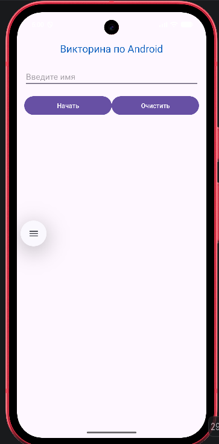
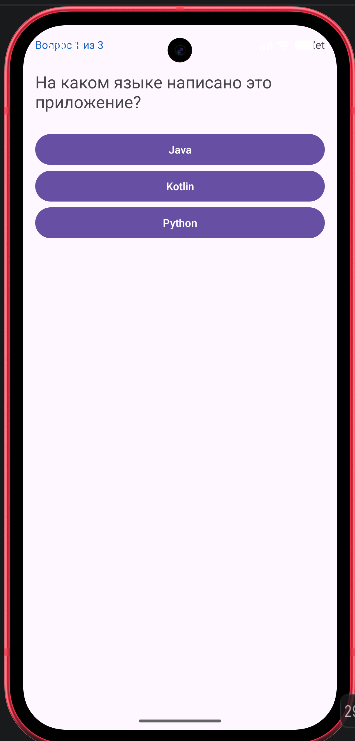
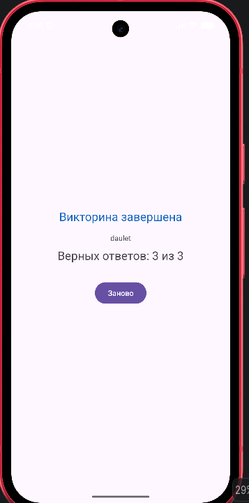

# Викторина (Mob Dev Практика)

Учебное Android-приложение на Kotlin: ввод имени, три вопроса, экран результата.

## Версии
- minSdk: 24
- targetSdk: 37
- compileSdk: 37
- Проверено на эмуляторе: Pixel 10a (API 37.2)
- Версия Android Studio: Android Studio Quail 4 | 2026.1.4

## Экраны
- MainActivity: ввод имени (LinearLayout)
- QuizActivity: вопросы (RelativeLayout)
- ResultActivity: результат

## Скриншоты

## Ссылки
- Логи: logs/logs.txt
- APK: app/build/outputs/apk/debug/app-debug.apk
